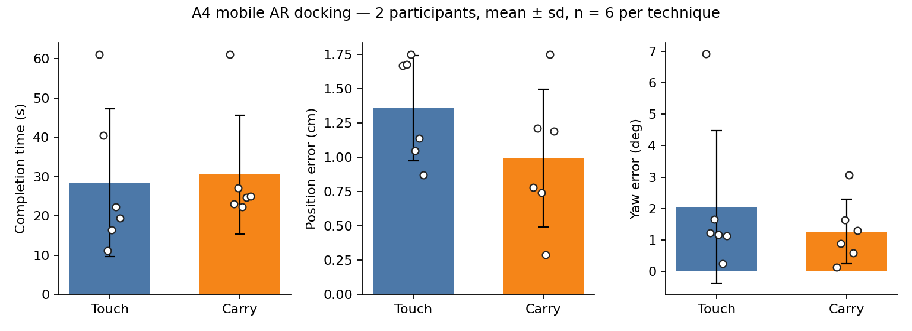
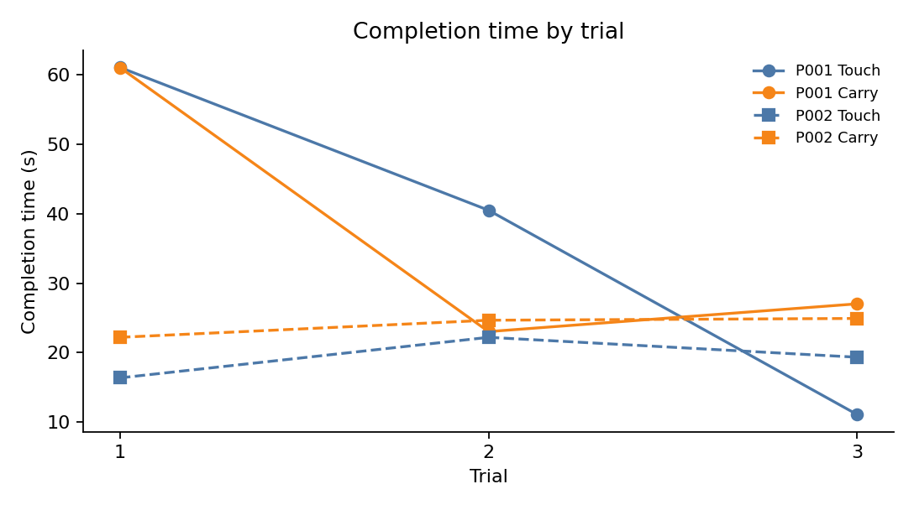

# MAC0623 Assignment 4 — Mobile AR Docking

**Course:** MAC0623 / MAC6923, 3D Interaction in Mixed Realities  
**Author:** José Luis La Torre Romero  
**Platform:** three.js + WebXR `immersive-ar` with `hit-test`  
**Live URL:** https://adminltr.github.io/A4-XR/  
**Source:** https://github.com/adminLTR/A4-XR  

This document is the full written deliverable: task, both techniques, the pre-implementation design draft for technique 2, instrumentation, results, and discussion.

---

## 1. Task and environment

The task is 3-DoF docking on a real horizontal surface. The phone is a monoscopic window onto the room. The user points the camera at a table, a green reticle appears when WebXR hit-testing finds a plane, and a tap (or the on-screen place button) anchors a workspace there. After that, hit-testing is no longer used to move the workspace: the cube and the ghost stay on that plane.

This build uses **one cube**, 20 cm on a side, instead of three separate objects of different colors. Opposite faces share a color (blue on ±X, yellow on ±Y, red on ±Z), so yaw is judged by which color faces which direction. A 180° turn looks the same as 0° and is counted as a match. The ghost is a translucent copy of the same cube, placed at the workspace origin with a random yaw. The movable cube starts about 18 cm to the side, also with a random yaw.

Docking succeeds when the horizontal distance is ≤ **2 cm** and the shortest color-equivalent yaw is ≤ **10°**. The HUD shows live position and yaw error. When both are inside tolerance the ghost glows green and the status line reads *Encajado*. The trial then ends automatically once the fingers leave the glass, or when the user taps **Finalizar intento**.

The stack is the same as A1–A3: three.js r160, `ARButton`, and the viewer-space hit-test loop from the official `webxr_ar_hittest` example. The page must be served over HTTPS. Desktop mode exists only for layout checks; logged trials were collected on an Android phone in Chrome with ARCore.

---

## 2. Technique 1 — Touch gestures (baseline)

After the cube is selected, one finger maps onto the table plane. A ray is cast from the camera through the touch point; the intersection with the workspace plane becomes the new (x, z) of the cube, with a grab offset so the cube does not jump under the finger. If that plane test misses, the finger delta is mapped onto the camera’s right/forward axes projected onto the table.

Two fingers rotate yaw only. The twist angle between the two contact points is applied to `rotation.y`. Translation and rotation therefore share the same glass surface and can couple: a two-finger pose that is not a pure twist also moves the cube, and the fingers cover the ghost while the user is trying to read the colors.

Selection is a tap-to-ray pick (Class 7, now from a touch). In this one-cube build the piece is already highlighted at trial start, so the selection step does not add a search among distractors.

---

## 3. Technique 2 — design draft (written before implementation)

The text below is the draft in `design_draft.md`. It was written before the logged trials, not after seeing `data.csv`.

**What it does.** After the user selects a piece, they hold an on-screen **Llevar** button. While the button is held, the selected object follows the intersection of the phone’s forward ray with the table plane: moving the phone moves the object (direct, isomorphic, like A2’s grab). Releasing the button parks it. Rotation is not a two-finger twist. It uses on-screen ↺ / ↻ buttons, so translation and yaw are separate modes.

**Course concept.**

- **Isomorphic / direct mapping** (A2 grab): the phone is already a tracked 6-DoF window onto the room. Using that motion to carry the object avoids the extra mapping from a 2D finger path onto the 3D plane.
- **Separated DoF**: two-finger gestures on a phone couple drag and twist, and the fingers cover the target (occlusion; Class 15 / AR perception). Putting yaw on buttons removes that coupling.

**Predicted trade-off.** Carry should be **faster for translation**, especially larger moves, because the user can walk the phone along the table instead of dragging a finger that also hides the ghost. The cost is **arm fatigue** (the phone must stay aimed at the table) and **slower / more stepwise rotation**. The draft predicted:

- lower `completion_time_s` than touch on trials with a large initial gap
- similar or slightly higher `yaw_error_deg` (discrete 8° button steps)
- higher “How tired are your arms?” (1–5)
- fewer `wrong_selections` and fewer fat-finger `touch_count` events, because motion is the phone, not a second gesture over the object

If that prediction failed, the draft named tracking drift while the arm is moving, or the clutch (hold / release) adding extra time, as the likely reasons.

**What was built.** The implementation matches the draft. Hold **Mantén para llevar** and the cube tracks the screen-centre ray on the table; release parks it. ↺ / ↻ nudge yaw by 8° and repeat at 90 ms while held. The cube never leaves the plane.

---

## 4. Instrumentation

The running app stores one in-memory row per finished trial and can download a CSV with the assignment fields: `participant_id`, `technique`, `trial`, `completion_time_s`, `pos_error_cm`, `yaw_error_deg`, `wrong_selections`, `touch_count`, `tracking_lost`.

Timing starts at the **first move** of the cube (first drag, twist, carry, or yaw nudge) and ends when the cube is docked. Position error is the horizontal distance in centimetres between cube and ghost. Yaw error is the smallest of the direct yaw difference and the 180°-equivalent difference, in degrees. `touch_count` increments on pointer-down during a trial. `tracking_lost` increments when hit-test results go from present to empty; after the workspace is placed the reticle is hidden, so this counter mainly covers the placement phase.

The file submitted with this report is `data.csv`. It is a reduced export: time, position error, and yaw error, plus trial index. `wrong_selections`, `touch_count`, and `tracking_lost` are not in this CSV. With a single cube there was no wrong-object selection to count.

| Field in `data.csv` | Meaning |
|---|---|
| `participant_id` | Anonymized id (`P001`, `P002`) |
| `technique` | `touch` or `carry` |
| `trial` | 1, 2, 3 counted separately inside each technique |
| `time_s` | Completion time in seconds |
| `dpos_cm` | Final position error in centimetres |
| `drot_deg` | Final yaw error in degrees |

---

## 5. Data collection

Two participants (not the author) completed three trials of each technique on an Android phone in Chrome with ARCore. That is 2 × 2 × 3 = **12 rows**. The CSV lists touch then carry for both people, so this is not ABBA: carry had more practice with the task, which works **in favour** of the prediction that carry would be faster.

| Participant | Block 1 | Block 2 | Surface / lighting |
|---|---|---|---|
| P001 | Touch, trials 1–3 | Carry, trials 1–3 | Indoor table through the phone camera; ARCore hit-test. Texture and illuminance were not logged in the CSV. |
| P002 | Touch, trials 1–3 | Carry, trials 1–3 | Same setup. |

Arm fatigue was asked for by the assignment but was **not recorded** in this CSV, so it cannot be reported as a number.

Protocol: enter AR, scan until the green reticle appears, place the workspace, dock until the HUD turns green. Practice before the logged trials was informal (getting hit-test to lock), not a fixed number of scored runs.

---

## 6. Results

Numbers come from `analyze_a4.py` on `data.csv`. Each pooled cell is six trials (two participants × three trials). Means are reported with the sample standard deviation. White dots in Figure 1 are the individual trials.

**Table 1.** Pooled performance by technique (n = 6).

| Technique | Time (s) | Position error (cm) | Yaw error (deg) | Arm fatigue (1–5) |
|---|---|---|---|---|
| Touch | 28.424 ± 18.845 | 1.360 ± 0.383 | 2.057 ± 2.421 | not collected |
| Carry | 30.475 ± 15.054 | 0.993 ± 0.503 | 1.268 ± 1.026 | not collected |

**Table 2.** Per participant (mean of 3 trials).

| Participant | Technique | Time (s) | Position (cm) | Yaw (deg) |
|---|---|---|---|---|
| P001 | touch | 37.544 | 1.700 | 3.260 |
| P001 | carry | 37.021 | 0.910 | 0.883 |
| P002 | touch | 19.304 | 1.020 | 0.853 |
| P002 | carry | 23.928 | 1.077 | 1.653 |

**Table 3.** Raw trials (`data.csv`).

| Participant | Technique | Trial | Time (s) | Position (cm) | Yaw (deg) |
|---|---|---|---|---|---|
| P001 | touch | 1 | 61.036 | 1.67 | 6.91 |
| P001 | touch | 2 | 40.491 | 1.68 | 1.22 |
| P001 | touch | 3 | 11.106 | 1.75 | 1.65 |
| P001 | carry | 1 | 61.015 | 0.78 | 0.14 |
| P001 | carry | 2 | 23.026 | 1.21 | 0.88 |
| P001 | carry | 3 | 27.021 | 0.74 | 1.63 |
| P002 | touch | 1 | 16.369 | 1.05 | 1.17 |
| P002 | touch | 2 | 22.202 | 1.14 | 0.25 |
| P002 | touch | 3 | 19.341 | 0.87 | 1.14 |
| P002 | carry | 1 | 22.205 | 0.29 | 3.07 |
| P002 | carry | 2 | 24.662 | 1.75 | 0.59 |
| P002 | carry | 3 | 24.918 | 1.19 | 1.30 |

Every logged trial finished inside tolerance (2 cm and 10°). Pooled mean time is **28.4 s for touch and 30.5 s for carry**: carry is about 2 s slower. That gap is not shared. P001’s means are almost equal (37.5 s touch, 37.0 s carry). P002 is faster with touch (19.3 s vs 23.9 s). P001’s first trial of each technique is 61 s; after that touch keeps falling to 11 s while carry stays in the mid-20 s. P002 never has that slow start: both techniques sit between 16 s and 25 s, and touch is faster on every trial.

Accuracy on the pooled means favours carry: 0.99 cm vs 1.36 cm, and 1.27° vs 2.06°. That accuracy gap is P001’s. P002 is slightly more accurate with touch on both position (1.02 cm vs 1.08 cm) and yaw (0.85° vs 1.65°). Touch yaw is pulled by P001 trial 1 (6.91°); without that row the two techniques are close.

Wrong selections, touch counts, tracking-lost counts, and arm fatigue have no numbers in this CSV.



*Figure 1. Mean ± sd for the three logged metrics. Dots are the 12 trials.*



*Figure 2. Completion time by trial. Solid = P001, dashed = P002.*

---

## 7. Discussion

The prediction was that **carry would be faster** than touch, especially on large translations, and that the cost would be **higher yaw error** (discrete buttons) and **higher arm fatigue**.

**The prediction was not supported.**

Pooled mean time is 28.4 s for touch and 30.5 s for carry. Carry is slower, not faster. P001 is a tie (37.5 s vs 37.0 s). P002 is faster with touch (19.3 s vs 23.9 s). Carry was the second block for both people, so it had extra practice, and it still lost on time. The clutch is a plausible reason: every carry dock needs a hold, a phone move, a release, then several ↺ / ↻ steps, while a practiced one-finger drag plus a short twist can finish in one motion. P001’s trial 3 shows that once the mapping is learned: 11 s touch vs 27 s carry.

The rotation-cost half of the prediction is mixed and does not save the speed claim. Pooled yaw error is **lower** for carry (1.27° vs 2.06°), the opposite of “buttons will be less accurate,” but that is P001’s first touch trial (6.91°). P002 matches the predicted cost: carry yaw 1.65° vs touch 0.85°. Pooled position error is lower for carry (0.99 cm vs 1.36 cm), again only for P001. P002’s position errors are almost the same. The assignment’s primary comparison was time, and time did not move in carry’s favour.

Fatigue cannot be used to salvage the trade-off: it was not written down. The design still *looks* more tiring (the phone must stay aimed at the table while the arm translates), but that is an observation from the technique, not a measured result.

Limits that a reader should not ignore: two participants, three trials, both people did touch first, a one-cube task with no distractor selection, and a reduced CSV. These numbers describe these two sessions. They do not estimate a population difference.

**AR-specific problems.** Tracking, not the mapping, dominated the start of P001’s session. Hit-test only lights the green reticle when ARCore has a textured plane; a bare table under weak light leaves the user scanning for tens of seconds before the cube can even be placed. After placement the workspace is frozen to that pose, so later tracking drift shows up as the cube sliding on the real table while the HUD still claims a 1 cm error — the numbers are in the virtual plane, not in centimetres of wood. The display is monoscopic, so depth is judged by contact with the table and by the live error readout more than by stereo. During touch, the fingers cover the ghost exactly when yaw is being judged; that occlusion is why the draft moved rotation onto buttons, and it matches P001’s first-trial yaw. During carry the opposite happens: the phone itself is the pointer, so the cube can leave the field of view if the user aims too steeply, and holding **Llevar** at the bottom of the screen occupies the same thumb that would otherwise stabilize the device. Those AR constraints, more than the 8° step size, are the likely reason carry never became the fast translation tool the draft expected. P002’s times sit in a narrow band around 20–25 s for both techniques, which looks like a user who already had the mapping and was paying the clutch cost rather than a tracking-search cost.

---

## 8. How to reproduce the numbers

```text
python analyze_a4.py
```

The script reads `data.csv`, prints Table 1, and writes `figures/a4_results.png` and `figures/a4_trials.png`. It accepts either the reduced headers in this file (`time_s`, `dpos_cm`, `drot_deg`) or the full app headers (`completion_time_s`, `pos_error_cm`, `yaw_error_deg`).
